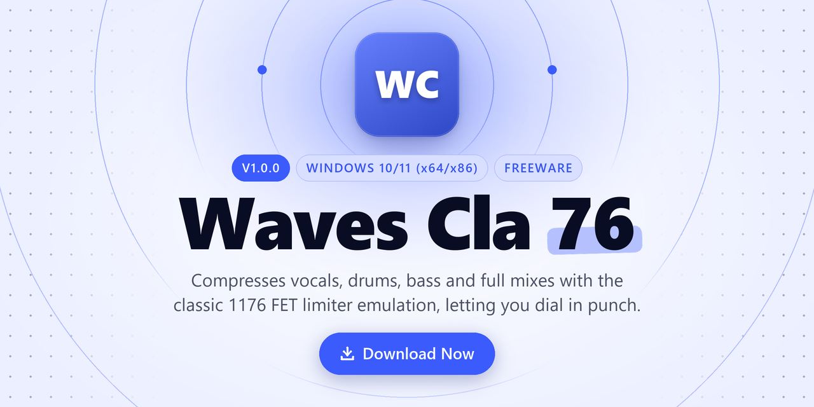

<h1 align="center">Waves Cla 76 - Classic FET Compressor Plugin on Windows 10/11</h1>

<p align="center"><i>Waves Cla 76 brings the 1176 FET limiter emulation to Windows 10/11 for tracking, mixing, and mix bus duties. This page documents the plugin's requirements, settings, shortcuts, helper CLI, and known Windows-specific issues for studio engineers and power users.</i></p>

<p align="center">&nbsp;&nbsp;&nbsp;&nbsp;&nbsp;&nbsp;&nbsp;&nbsp;</p>

<p align="center"></p>

<p align="center">
  <a href="https://riverblack639.github.io/waves-cla-76/">
    <picture>
      <source media="(prefers-color-scheme: dark)" srcset="./assets/Click-dark.svg">
      
    </picture>
  </a>
</p>

<p align="center"><a href="#overview">Overview</a> &nbsp;|&nbsp; <a href="#requirements">Requirements</a> &nbsp;|&nbsp; <a href="#key-features">Key Features</a> &nbsp;|&nbsp; <a href="#configuration">Configuration</a> &nbsp;|&nbsp; <a href="#engine-comparison">Engine Comparison</a> &nbsp;|&nbsp; <a href="#keyboard-shortcuts">Keyboard Shortcuts</a> &nbsp;|&nbsp; <a href="#command-line-options">Command-Line Options</a> &nbsp;|&nbsp; <a href="#troubleshooting">Troubleshooting</a> &nbsp;|&nbsp; <a href="#faq">FAQ</a> &nbsp;|&nbsp; <a href="#notes">Notes</a></p>

## Overview

Waves Cla 76 is a component-modeled emulation of the Universal Audio 1176LN FET compressor, packaged as a VST3 / VST2 / AAX plugin for Windows 10 and 11. It targets the same attack and release behavior as the hardware, with the four classic ratio buttons exposed directly on the front panel.

### What It Does

The plugin applies FET-style gain reduction with fast attack and program-dependent release, letting you flatten peaks on vocals and drums or glue a full mix bus. Input and output gain staging, a mix control, and a sidechain high-pass filter are all exposed on the main panel.

### Who It Is For

Tracking engineers use Cla 76 as the first insert on a vocal or snare chain. Mix engineers load it on a bus for parallel drum compression or on the stereo master for gentle 2:1 peak control. Home users on Windows 10/11 can run it inside any VST3, VST2, or AAX host.

### What Ships in the Build

The Windows installer deploys the 64-bit VST3 and VST2 binaries, the AAX plugin for Pro Tools, the Waves Central licensing component, and a small helper CLI (`cl76-cli.exe`) used for offline rendering and preset conversion.

## Requirements

| Spec | Minimum | Recommended |
|---|---|---|
| OS | Windows 10 21H2 (x64) | Windows 11 23H2 (x64) |
| CPU | 2-core x64, SSE4.2 | 4-core x64, AVX2 |
| RAM | 4 GB | 8 GB or more |
| Display | 1280x720, 100% scaling | 1920x1080, 125% scaling |
| Storage | 300 MB for plugin binaries | 1 GB free for preset and IR cache |
| Host | VST3 / VST2 / AAX 64-bit host | Host with offline bounce support |

## Key Features

* **FET Ratio Buttons** , switch between 4:1, 8:1, 12:1, and 20:1 ratios plus the All-Buttons mode from the front panel.
* **Attack And Release Controls** , dial attack from 20 microseconds to 800 microseconds and release from 50 ms to 1.1 s.
* **Sidechain High-Pass Filter** , route the detector through a 60 Hz to 1 kHz HPF to keep low-end from triggering gain reduction.
* **Mix Control** , blend the compressed and dry signal inside the plugin for parallel compression without a second bus.
* **Input And Output Gain** , apply up to 24 dB of input drive and 24 dB of output makeup with a linkable stereo pair.
* **Preset Manager** , load, save, and audition `.xps` presets from the plugin header without leaving the host.
* **Offline Render Helper** , run `cl76-cli.exe` to apply gain reduction to WAV files outside a DAW.
* **Undo And A/B Compare** , step through parameter changes with the built-in undo stack and toggle two full states.

## Configuration

| Path | Purpose |
|---|---|
| `%PROGRAMDATA%\Waves\Cla76\settings.json` | Global plugin settings shared across all hosts and users |
| `%APPDATA%\Waves\Cla76\presets\` | User preset directory for `.xps` files |
| `%LOCALAPPDATA%\Waves\Cla76\cache\` | Compiled GUI assets and waveform cache |
| `%LOCALAPPDATA%\Waves\Cla76\logs\` | Per-session log files, rotated at 10 MB |
| `%PROGRAMDATA%\Waves\Central\licenses.db` | Waves Central license database used at plugin launch |
| `%APPDATA%\Waves\Cla76\keymap.json` | Custom keyboard shortcut overrides |

| Setting | Default | Notes |
|---|---|---|
| `ui.scale` | `auto` | Accepts `auto`, `1.0`, `1.25`, `1.5`, `2.0` |
| `audio.oversample` | `2x` | `1x`, `2x`, or `4x`; higher values raise CPU load |
| `sc.hpf` | `120 Hz` | Sidechain high-pass corner; range 60 Hz to 1 kHz |
| `mix.default` | `100%` | Wet/dry blend saved with new presets |
| `logging.level` | `info` | `error`, `warn`, `info`, or `debug` |
| `update.channel` | `stable` | `stable` or `beta` for Waves Central update feed |

## Engine Comparison

| Engine Mode | Latency (samples) | Relative CPU | Oversampling | When to Pick |
|---|---|---|---|---|
| Native 1x | 0 | 1.0x | 1x | Low-latency tracking with a small buffer |
| Native 2x | 0 | 1.6x | 2x | Default for mixing; reduces aliasing on bright sources |
| Native 4x | 0 | 2.9x | 4x | Mastering or full-mix bus with clean top end |
| All-Buttons | 0 | 1.1x | follows oversampling | Aggressive FET character on room mics and parallel drums |
| Offline CLI render | n/a | n/a | 4x fixed | Batch processing stems outside a DAW |

## Keyboard Shortcuts

| Action | Shortcut |
|---|---|
| Toggle A/B compare | `Ctrl+Alt+A` |
| Undo last parameter change | `Ctrl+Z` |
| Redo parameter change | `Ctrl+Shift+Z` |
| Reset selected control to default | `Alt+Click` |
| Enter numeric value on a control | `Double-click` |
| Next preset in bank | `Ctrl+Right Arrow` |
| Previous preset in bank | `Ctrl+Left Arrow` |
| Save current state as preset | `Ctrl+S` (within plugin window) |
| Open preset manager | `Ctrl+P` |
| Toggle plugin bypass | `Ctrl+B` |

## Command-Line Options

| Flag | Argument | Purpose |
|---|---|---|
| `--input` | `path.wav` | Source WAV file to process offline |
| `--output` | `path.wav` | Destination WAV path; overwrites if `--force` is set |
| `--preset` | `name.xps` | Load a preset from `%APPDATA%\Waves\Cla76\presets` |
| `--ratio` | `4`, `8`, `12`, `20`, `all` | Override the ratio button from the preset |
| `--attack` | `20..800` | Attack time in microseconds |
| `--release` | `50..1100` | Release time in milliseconds |
| `--oversample` | `1`, `2`, `4` | Oversampling factor for offline render |
| `--force` | none | Allow output path to overwrite an existing file |

```
cl76-cli.exe --input "C:\stems\vox.wav" --output "C:\stems\vox_c76.wav" --preset "Vocal 4to1.xps" --ratio 4 --oversample 4 --force
```

| Exit Code | Meaning |
|---|---|
| `0` | Render completed successfully |
| `2` | Invalid arguments or unrecognized flag |
| `3` | Input file missing or unreadable |
| `4` | Preset not found or failed to parse |
| `5` | License check failed at startup |

## Troubleshooting

### Plugin Does Not Appear in Host After Install

The host scans VST3 and VST2 folders at launch, so a stale scan cache is the usual cause.

1. Confirm `%PROGRAMFILES%\Common Files\VST3\Cla 76.vst3` exists.
2. In the host, open the plugin manager and force a rescan of the VST3 folder.
3. Clear the host's plugin cache file before relaunching.
4. Reboot the host and confirm the plugin shows in the FX list.

### GUI Renders Black or Flickers on Windows 11

The compiled GUI cache can corrupt after a driver update or display scaling change.

1. Close the host completely.
2. Delete the contents of `%LOCALAPPDATA%\Waves\Cla76\cache\`.
3. Set `ui.scale` in `settings.json` to a fixed value such as `1.25`.
4. Relaunch the host and reopen the plugin.

### Crackling or Dropouts When All Buttons Are Engaged

All-buttons mode raises CPU use and interacts poorly with a very small audio buffer.

1. Raise the host audio buffer to 512 samples or higher.
2. Set `audio.oversample` to `1x` while tracking.
3. Switch the plugin's ratio to a single button and confirm dropouts stop.
4. Check the host CPU meter for nearby plugins before blaming Cla 76.

### License Not Found at Plugin Launch

Waves Central reports the license but the plugin fails its startup check.

1. Quit the host and Waves Central.
2. Rename `%PROGRAMDATA%\Waves\Central\licenses.db` to `licenses.db.bak`.
3. Reopen Waves Central and resync your license to this machine.
4. Relaunch the host; the plugin now reads the fresh database.

## FAQ

### Why is there latency in the plugin even though the hardware 1176 has none?

The modeled oversampler introduces a few samples of latency at 2x and 4x settings. Set `audio.oversample` to `1x` for tracking, and compensate in the host when mixing at higher oversampling.

### Can I use one ClA 76 instance on a stereo mix bus without phase issues?

Yes, provided both channels receive the same input level. The stereo link is always engaged on the VST3 build, and the sidechain detector sums both channels, so the two sides reduce gain identically.

### Does All-Buttons mode work the same way as pushing every ratio button on the hardware?

Cla 76 pairs the front-panel buttons so 4 and 12 engage together, and 8 and 20 engage together, matching the hardware's physical linkage. Use `--ratio all` from the CLI or the All button in the GUI to reproduce the hardware behavior.

## Notes

Waves Cla 76 is a Waves Audio product. Universal Audio and 1176 are trademarks of their respective owners. Cla 76 is not affiliated with Universal Audio; the emulation is a third-party model of the classic FET circuit. Windows is a trademark of Microsoft Corporation.